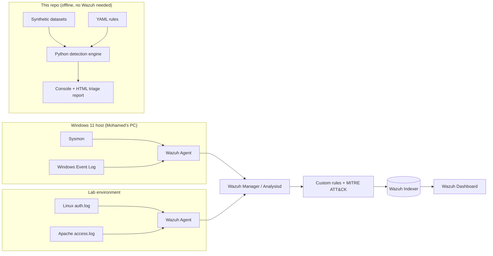
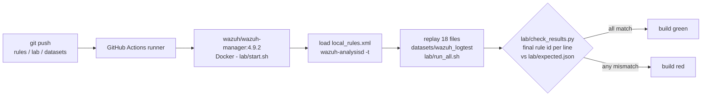

# SOC Detection Lab

A defensive, **100% offline** detection-engineering portfolio project: synthetic
security logs, a set of custom detection rules (Wazuh XML + Sigma YAML) mapped to
MITRE ATT&CK, and a small Python **detection engine** that runs the rules over the
logs and produces a triage report.

> Everything here is synthetic and defensive. No malware, no third-party targets,
> no paid APIs. IPs use the RFC 5737 documentation ranges and RFC 1918 private
> ranges; hosts and users are fictional.

**Author:** Mohamed Elansari — cybersecurity student
**Status:** The offline detection engine, rules, synthetic datasets and tests are
**built and passing**. The Wazuh rules are **validated automatically in CI**
(GitHub Actions) on a real **Wazuh 4.9.2 manager** in Docker: **18/18
`wazuh-logtest` replay cases pass**, negatives included (see
[Detection-as-code CI](#detection-as-code-ci) and
[`docs/WAZUH-VALIDATION.md`](docs/WAZUH-VALIDATION.md)). These are synthetic lines
replayed in `wazuh-logtest`: **no live agent yet** — the end-to-end case with a
real Windows agent + Sysmon + real RDP (case 19) is still to do, and the full
deployment in SETUP.md (indexer, dashboard, agents) has not been run.

---

## Architecture



The **offline engine** reproduces the detection logic of the Wazuh/Sigma rules so
the project is fully demonstrable without deploying a SIEM. The same 12 detections
exist in three forms: Wazuh XML, Sigma YAML, and the engine's own YAML. Where the
formats cannot express exactly the same thing, the difference is listed in
`docs/WAZUH-VALIDATION.md` §3 (for example, Wazuh cannot join the 4720 `TargetSid`
with the 4732 `MemberSid`, so its "new local admin" rule correlates per host).

---

## Detection coverage

| # | Detection | ATT&CK | Data source | Engine rule type |
|---|-----------|--------|-------------|------------------|
| 1 | SSH brute force | T1110 | Linux auth.log | threshold |
| 2 | RDP/Windows logon brute force | T1110 | Windows Security 4625 | threshold |
| 3 | Successful login after many failures | T1110 | Linux auth.log | sequence |
| 4 | New local account added to Administrators (joined on the account SID: 4720 `TargetSid` = 4732 `MemberSid`) | T1136.001 / T1098 | Windows Security 4720+4732 | sequence |
| 5 | Suspicious PowerShell encoded command | T1059.001 | Sysmon EID 1 | single |
| 6 | Scheduled task creation | T1053.005 | Windows Security 4698 / Sysmon EID 1 | single |
| 7 | Windows event log cleared | T1685.005 (ex-T1070.001) | Windows Security 1102 | single |
| 8 | Port scan from one source | T1046 | Sysmon EID 3 | distinct |
| 9 | Microsoft Defender disabled | T1685 (ex-T1562.001) | Sysmon EID 1 (+ Defender 5001 in Wazuh/Sigma) | single |
| 10 | Web shell interaction (behaviour-based: OS command in a `cmd=`-style parameter, PHP code-exec / base64 payload, successful POST to a script in an upload dir) | T1505.003 | Apache access.log | single |
| 11 | Office application spawning a shell | T1204.002 | Sysmon EID 1 | single |
| 12 | **Remote logon success after brute force** (8+ 4625 of type 3/10, then 4624 type 10 or type 3 NTLM, same source IP, 180 s) | T1110 + T1078 | Windows Security 4625+4624 | sequence |

> **ATT&CK version note.** ATT&CK v19 (April 2026) revoked T1562.001 and T1070.001
> (Defense Evasion was split into *Stealth* and *Defense Impairment*). The Sigma
> rules and the engine use the current IDs (T1685, T1685.005); the Wazuh rules keep
> the legacy IDs because Wazuh's bundled MITRE database predates v19.

---

## Results of the offline run

Reproducible run over the fixed-seed synthetic dataset:

- **Events analyzed:** 307 (Linux auth, Windows Security, Sysmon, Apache)
- **Alerts raised:** 16
- **Detections that fired on their attack sample:** **12 / 12**
- **False positives on the benign-only baseline (246 events):** **0**. The baseline
  now contains deliberate near misses: 7 SSH failures then a success, 7 RDP
  failures then an RDP logon, 3 failures then an NTLM logon, an account created
  while an *existing* account is added to Administrators, and web requests such as
  `/search?q=evaluation`, `?q=whoami+command`, `?id=42`, `?c=dark-mode`, an image
  POSTed to `/uploads/`. The previous versions of rules 4 and 10 raised **3 false
  positives** on these near misses; the revised rules raise none.
- **Tests:** 145 passed (`pytest`): entity and hit count per alert, threshold
  edges (7 vs 8 failures, 14 vs 15 distinct ports), window edges (180 s vs 181 s),
  sequence ordering, SID join, web-shell positives and negatives checked against
  the engine **and** the Sigma **and** the Wazuh regexes, generator determinism.
- **Sigma:** `sigma check` gives 0 errors, 0 condition errors, 0 issues
  (21 rule documents).

> Note on the alert count (16 > 12): the web-shell rule fires once per malicious
> request (4) and the scheduled-task rule matches both the Security event and the
> Sysmon `schtasks.exe` event (2). Each alert points to a distinct log line.
>
> How much this proves: the attacks and the baseline both come from the same
> generator, written by the same person who wrote the rules. "0 FP" here means
> "not trivially noisy, and robust to the near misses I thought of", not "FP-free
> on real logs".

Reports are written to `reports/triage.html` and `reports/alerts.json`.

---

## Detection-as-code CI

Workflow [`.github/workflows/wazuh-validation.yml`](.github/workflows/wazuh-validation.yml)
runs on every push that touches `rules/**`, `lab/**` or `datasets/wazuh_logtest/**`:



- **Result (2026-10-03): 18/18 cases**, including 5 negative cases (7 failures
  then success, Kerberos success, benign web look-alikes). Case 08 fires 100131 as
  documented (known limitation: Wazuh cannot join the 4720 `TargetSid` with the
  4732 `MemberSid`), which is the expected behaviour.
- **It took 4 runs.** Run 1 failed on a readiness-check bug. Run 2: all Windows
  events fell to rule 1002, because the test patch of rule 60000 must also drop
  `<category>ossec</category>` (as Wazuh's own `runtests.py` does), and built-in
  31108 (level 0) captured the POST meant for 100192. Run 3: 15/18 — built-in
  92653 / 92652 captured the RDP / NTLM success before 100122 / 100123, and 2 of
  15 Sysmon EID 3 events ended on 92106, so the port-scan counter reached 13.
  Run 4: 18/18 after attaching the custom rules under those built-in children.
- **Lesson:** reading the 4.9.2 source suggested that sibling rules are tried by
  descending level; in practice the built-in children, loaded first, won. The
  robust fix is to put custom rules under every built-in child that may capture
  the event — and to keep the CI so this never regresses.
- **What it does not prove:** the lines are synthetic and replayed in
  `wazuh-logtest`. There is no agent on a real machine yet (case 19 pending).

---

## Quick start

```bash
# from the repo root (Python 3.11, no external services)
python -m pip install -r requirements.txt

python datasets/generate.py        # (re)generate the synthetic logs
python tools/make_wazuh_samples.py # (re)build the wazuh-logtest replay files
python detector/run.py             # run detections -> console + HTML report
python -m pytest -q                # run the test suite
sigma check rules/sigma            # validate the Sigma rules (pip install sigma-cli)
```

Open `reports/triage.html` in a browser to see the triage dashboard.

---

## Repository layout

```
soc-detection-lab/
├── .github/workflows/        wazuh-validation.yml (detection-as-code CI)
├── README.md                 this file
├── LEARN.md                  SIEM concepts + interview Q&A (French)
├── requirements.txt
├── docs/
│   ├── SETUP.md              Wazuh lab deployment plan (French)
│   ├── INCIDENT-REPORT.md    full incident report on the synthetic scenario (French)
│   ├── ATTACK-SIMULATION.md  benign self-tests to trigger the rules (French)
│   └── WAZUH-VALIDATION.md   wazuh-logtest checklist, rule by rule (French)
├── rules/
│   ├── wazuh/local_rules.xml custom Wazuh rules (MITRE-mapped)
│   ├── sigma/*.yml           equivalent Sigma rules
│   └── README.md             how to validate the rules
├── datasets/
│   ├── generate.py           deterministic synthetic log generator (seed=1337)
│   ├── auth.log              Linux SSH/sudo
│   ├── windows_security.jsonl
│   ├── sysmon.jsonl
│   ├── apache_access.log
│   └── wazuh_logtest/        lines to paste into wazuh-logtest (generated)
├── detector/
│   ├── parsers.py            normalize the 4 log formats
│   ├── engine.py             match + threshold/distinct/sequence correlation
│   ├── report.py             console + HTML rendering
│   ├── run.py                CLI entry point
│   └── rules/*.yaml          engine rules (one per detection)
├── lab/                      CI scripts: start.sh, run_all.sh, check_results.py, expected.json
├── tools/make_wazuh_samples.py  dataset -> Wazuh eventchannel JSON replay files
├── tests/test_detector.py    pytest (entities, counts, edges, cross-format checks)
└── reports/                  generated triage output
```

---

## Limitations (honest)

- The offline engine is a **teaching/demonstration** correlator, not a production
  SIEM. It loads all events into memory and runs simple sliding-window
  correlation; it is not streaming or distributed.
- Rules are tuned against **synthetic** data with clean field names. Real logs are
  noisier; thresholds (e.g. 8 failures / 120s, 15 ports / 60s) will need tuning on
  live data to balance detection vs. false positives.
- **Wazuh rules: validated in CI by logtest replay, not yet end to end.** All 19
  rule IDs (100110 to 100200) are loaded on a real Wazuh 4.9.2 manager and the 18
  `wazuh-logtest` cases pass in CI (see above). The Windows cases need a temporary
  CI-only patch of rule 60000 (the one used by Wazuh's `runtests.py`), because
  pasted eventchannel JSON is decoded as `json`. Still **not validated**: a real
  Windows agent with Sysmon and a real RDP logon (checklist case 19). Correlation
  timing on real agent traffic and real-log false-positive rates are untested.
- Wazuh's "new local admin" rule (100131) correlates per host, not per SID, so it
  fires for "account A created, unrelated account B added to Administrators". The
  engine and Sigma join on the SID.
- The Sigma rules pass `sigma check` (sigma-cli 3.1 / pySigma 1.5, 0 errors, 0
  issues). Threshold rules use **Sigma v2 correlation rules** (`event_count`,
  `value_count`, `temporal_ordered`). Single-event and count rules convert to SPL
  with the Splunk backend; `temporal_ordered` (success-after-failures, RDP success
  after brute force, new local admin) is valid Sigma but not supported by every
  backend. The web-shell regexes use look-aheads, which some backends do not
  support.
- The behaviour-based web-shell rule only sees what an access log records: it
  misses web shells driven through POST bodies or cookies, and renamed parameters
  (`?zz=whoami`). Host telemetry (the web server spawning `whoami`/`id`) is the
  stronger signal.
- The 0-false-positive result is measured on benign noise produced by the **same
  generator** that produces the attacks, so it proves the rules are not trivially
  noisy, not that they are FP-free on real logs (e.g. a software installer running
  `schtasks /create` will fire the medium-severity scheduled-task rule).
- No endpoint/EDR telemetry beyond Sysmon process/network events; detections like
  "Office spawns shell" depend on Sysmon being installed with a good config.

---

## Résumé (français)

Projet de **detection engineering** défensif et **entièrement hors-ligne**. Il
contient : des journaux synthétiques (Linux, Windows Security, Sysmon, Apache),
12 détections personnalisées (règles Wazuh XML + Sigma YAML) mappées à
**MITRE ATT&CK**, et un **moteur de détection Python** qui exécute les règles sur
les journaux et produit un rapport de triage (console + HTML).

**Résultats :** 307 évènements analysés, 16 alertes, 12/12 détections déclenchées
sur leur attaque, **0 faux positif** sur la base de référence bénigne (246
évènements, dont des quasi-attaques), 145 tests `pytest` au vert, `sigma check`
sans erreur. La 12ᵉ détection couvre la **connexion RDP réussie après force
brute** (T1110 + T1078), étape du rapport d'incident qui n'était pas détectée.

Le **moteur offline + les règles sont réalisés** ; le **déploiement Wazuh complet**
(manager + indexer + dashboard + agent, voir `docs/SETUP.md`) est prévu pour être exécuté par Mohamed sur sa propre
machine. Les **règles Wazuh sont validées automatiquement en CI** (GitHub
Actions, detection-as-code) sur un vrai manager **Wazuh 4.9.2** en Docker :
**18/18 cas `wazuh-logtest`**, dont des cas négatifs ; tout écart avec
`lab/expected.json` fait échouer le build. Il a fallu 4 runs : les règles intégrées
enfants (92653, 92652, 92106, 31108), chargées en premier, capturaient les
évènements avant les règles locales de niveau plus élevé ; le correctif a été de
rattacher les règles locales sous ces enfants intégrés. **Pas encore fait :** le
cas 19 (agent Windows réel + Sysmon + vraie connexion RDP) ; il s'agit de lignes
synthétiques rejouées, pas d'une supervision en direct (détails :
`docs/WAZUH-VALIDATION.md`). Aucune API payante, aucun logiciel malveillant, aucune cible tierce ;
adresses IP en plages de documentation (RFC 5737) et privées (RFC 1918).
