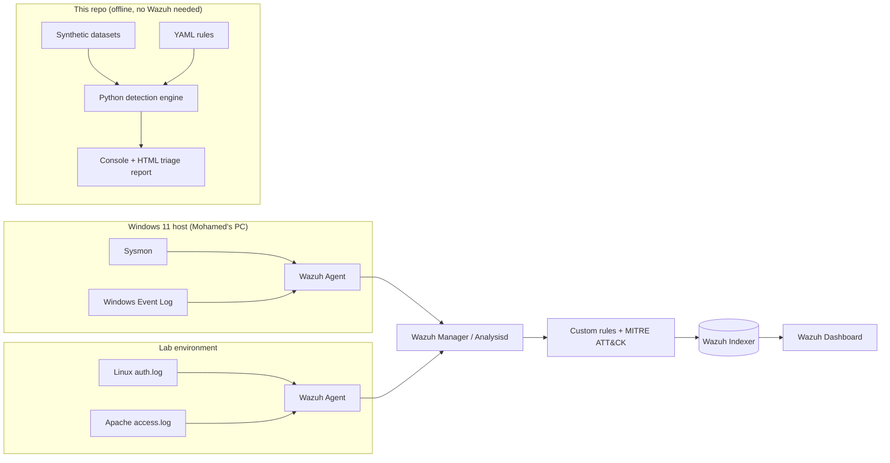

# SOC Detection Lab

A defensive, **100% offline** detection-engineering portfolio project: synthetic
security logs, a set of custom detection rules (Wazuh XML + Sigma YAML) mapped to
MITRE ATT&CK, and a small Python **detection engine** that runs the rules over the
logs and produces a triage report.

> Everything here is synthetic and defensive. No malware, no third-party targets,
> no paid APIs. IPs use the RFC 5737 documentation ranges and RFC 1918 private
> ranges; hosts and users are fictional.

**Author:** Mohamed Elansari — cybersecurity student
**Status:** The offline detection engine, rules, synthetic datasets and tests are
**built and passing**. The live Wazuh deployment (SETUP.md) is designed to be run
by the author on his own machine — it is **not** executed in this repository.

---

## Architecture



The **offline engine** reproduces the detection logic of the Wazuh/Sigma rules so
the project is fully demonstrable without deploying a SIEM. The same 11 detections
exist in three forms: Wazuh XML, Sigma YAML, and the engine's own YAML.

---

## Detection coverage

| # | Detection | ATT&CK | Data source | Engine rule type |
|---|-----------|--------|-------------|------------------|
| 1 | SSH brute force | T1110 | Linux auth.log | threshold |
| 2 | RDP/Windows logon brute force | T1110 | Windows Security 4625 | threshold |
| 3 | Successful login after many failures | T1110 | Linux auth.log | sequence |
| 4 | New local account added to Administrators | T1136.001 / T1098 | Windows Security 4720+4732 | sequence |
| 5 | Suspicious PowerShell encoded command | T1059.001 | Sysmon EID 1 | single |
| 6 | Scheduled task creation | T1053.005 | Windows Security 4698 / Sysmon EID 1 | single |
| 7 | Windows event log cleared | T1070.001 | Windows Security 1102 | single |
| 8 | Port scan from one source | T1046 | Sysmon EID 3 | distinct |
| 9 | Microsoft Defender disabled | T1562.001 | Sysmon EID 1 | single |
| 10 | Web shell-like request | T1505.003 | Apache access.log | single |
| 11 | Office application spawning a shell | T1204.002 | Sysmon EID 1 | single |

---

## Results of the offline run

Reproducible run over the fixed-seed synthetic dataset:

- **Events analyzed:** 275 (Linux auth, Windows Security, Sysmon, Apache)
- **Alerts raised:** 14
- **Detections that fired on their attack sample:** **11 / 11**
- **False positives on the benign-only baseline (215 events):** **0**
- **Tests:** 30 passed (`pytest`)

> Note on the alert count (14 > 11): the web-shell rule fires once per malicious
> request (3) and the scheduled-task rule matches both the Security event and the
> Sysmon `schtasks.exe` event (2). This is expected, honest behaviour, not
> double-counting of a single detection — each alert points to a distinct log line.

Reports are written to `reports/triage.html` and `reports/alerts.json`.

---

## Quick start

```bash
# from the repo root (Python 3.11, no external services)
python -m pip install -r requirements.txt

python datasets/generate.py        # (re)generate the synthetic logs
python detector/run.py             # run detections -> console + HTML report
python -m pytest -q                # run the test suite
```

Open `reports/triage.html` in a browser to see the triage dashboard.

---

## Repository layout

```
soc-detection-lab/
├── README.md                 this file
├── LEARN.md                  SIEM concepts + interview Q&A (French)
├── requirements.txt
├── docs/
│   ├── SETUP.md              Wazuh lab deployment plan (French)
│   ├── INCIDENT-REPORT.md    full incident report on the synthetic scenario (French)
│   └── ATTACK-SIMULATION.md  benign self-tests to trigger the rules (French)
├── rules/
│   ├── wazuh/local_rules.xml custom Wazuh rules (MITRE-mapped)
│   ├── sigma/*.yml           equivalent Sigma rules
│   └── README.md             how to validate the rules
├── datasets/
│   ├── generate.py           deterministic synthetic log generator (seed=1337)
│   ├── auth.log              Linux SSH/sudo
│   ├── windows_security.jsonl
│   ├── sysmon.jsonl
│   └── apache_access.log
├── detector/
│   ├── parsers.py            normalize the 4 log formats
│   ├── engine.py             match + threshold/distinct/sequence correlation
│   ├── report.py             console + HTML rendering
│   ├── run.py                CLI entry point
│   └── rules/*.yaml          engine rules (one per detection)
├── tests/test_detector.py    pytest (true/false positive per rule)
└── reports/                  generated triage output
```

---

## Limitations (honest)

- The offline engine is a **teaching/demonstration** correlator, not a production
  SIEM. It loads all events into memory and runs simple sliding-window
  correlation; it is not streaming or distributed.
- Rules are tuned against **synthetic** data with clean field names. Real logs are
  noisier; thresholds (e.g. 8 failures / 120s, 15 ports / 60s) will need tuning on
  live data to balance detection vs. false positives.
- The Wazuh rules reference standard decoder SIDs (e.g. sshd `5710`, Windows
  eventchannel `60000`, Sysmon `61603/61605`, web `31100`); exact parent SIDs can
  differ between Wazuh versions and must be verified with `wazuh-logtest` after
  deployment.
- The Sigma rules use correlation syntax (`count() by ...`) that requires a
  modern Sigma backend/`sigma correlation` support to convert to some targets.
- No endpoint/EDR telemetry beyond Sysmon process/network events; detections like
  "Office spawns shell" depend on Sysmon being installed with a good config.

---

## Résumé (français)

Projet de **detection engineering** défensif et **entièrement hors-ligne**. Il
contient : des journaux synthétiques (Linux, Windows Security, Sysmon, Apache),
11 détections personnalisées (règles Wazuh XML + Sigma YAML) mappées à
**MITRE ATT&CK**, et un **moteur de détection Python** qui exécute les règles sur
les journaux et produit un rapport de triage (console + HTML).

**Résultats :** 275 évènements analysés, 11/11 détections déclenchées sur leur
attaque, **0 faux positif** sur la base de référence bénigne (215 évènements),
30 tests `pytest` au vert.

Le **moteur offline + les règles sont réalisés** ; le **déploiement Wazuh réel**
(voir `docs/SETUP.md`) est prévu pour être exécuté par Mohamed sur sa propre
machine. Aucune API payante, aucun logiciel malveillant, aucune cible tierce ;
adresses IP en plages de documentation (RFC 5737) et privées (RFC 1918).
